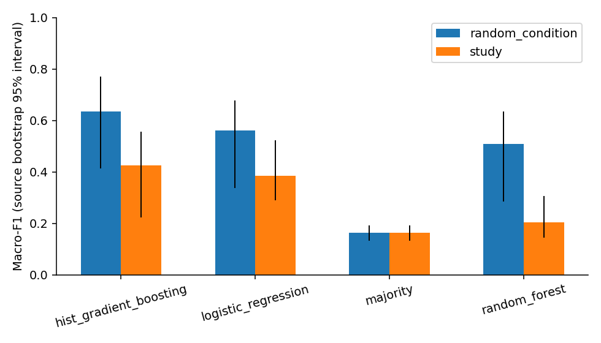

# CO₂RR cross-study product-label evaluation

An auditable evaluation of product labels from published CO₂ electroreduction experiments, focused on **organically modified copper catalysts**. This project compares random condition-grouped and paper-disjoint evaluation, feature ablations, and training-only probability calibration using small CPU models.

[Interactive research website](https://co2rr-cross-study-research.zq20021102mia.chatgpt.site) · [English report (PDF)](report/report_en.pdf) · [Full report (Markdown)](report/report_en.md) · [中文结果解读](report/interpretation_zh.md) · [Frozen protocol](docs/evaluation_protocol.md) · [Data audit](docs/data_audit.md)


## Phase 2: Bayesian optimization replay

[Results and reproduction](phase2/README.md) · [Protocol](phase2/PROTOCOL.md) · [Data sources](phase2/SOURCES.md) · [Interactive website](https://co2rr-cross-study-research.zq20021102mia.chatgpt.site/#phase2)

The follow-up tests sequential experiment selection using historical CO₂RR measurements. At a budget of six conditions in the 11-condition acetate cohort from Li et al., Gaussian-process expected improvement found the best recorded condition in 100.0% of 500 paired replays, compared with 54.8% for random selection. The candidate pool contains previously measured conditions, and the result is retrospective.

## Research scope

The primary cohort contains **86 recorded conditions from 22 explicit DOI groups**, with four labels: C₂H₄, C₂H₅OH, CH₄ and CO. Each label is the individual carbon species with the **highest explicitly reported numeric Faradaic efficiency**, conditional on at least two reported individual carbon species and a unique positive maximum. Unreported species remain unknown; this is not a complete product-distribution target.

The two datasets initially proposed could not be acquired as usable tables. The admitted alternative is a pinned public [Wang Group workbook](https://github.com/Wang-Group/Cu-CO2RR_modifiers), with its actual 322 rows audited before modeling. Full provenance and failed acquisition attempts are documented in [data_sources.md](docs/data_sources.md). Original and full curated measurement tables are retrieved/regenerated locally, rather than committed here.

## Executed results

The following values come from saved outer predictions. Nonbaseline rows use combined modifier and condition features. Both protocols use the same 86 records; the majority baseline is feature-independent.

| Model | Random condition-grouped macro-F1 | Held-out-paper macro-F1 | Held-out-paper accuracy |
| --- | ---: | ---: | ---: |
| Majority baseline | 0.164 | 0.164 | 0.488 |
| Logistic regression | 0.562 | 0.385 | 0.477 |
| Random forest | 0.508 | 0.205 | 0.500 |
| Gradient boosting | 0.634 | 0.424 | 0.512 |



Cross-study performance is limited. Combining feature groups is model-dependent, and sigmoid calibration does not consistently improve probability scores or classification. Study-disjoint calibration is feasible for **56/86 records from 14 DOI groups**; it is compared with uncalibrated predictions on exactly that subset, separately from full-cohort results. The report includes per-class recall, equal-study metrics, paired source-bootstrap comparisons and failure diagnostics.

These findings describe a small selected copper-modifier corpus. They do not establish a new learning method, a chemical mechanism or validated experimental recommendations. See [limitations](docs/limitations.md).

## Reproduce

Validated on Linux with Python **3.12.14**, using CPU only. No GPU or API key is needed.

```bash
git clone https://github.com/QiZhang1102/co2rr-cross-study.git
cd co2rr-cross-study
python3.12 -m venv .venv
source .venv/bin/activate
python -m pip install -r requirements.txt
python scripts/reproduce.py
```

Because this is a private repository, cloning requires your usual GitHub access. The reproduction command downloads the 44,842-byte workbook at a pinned Git commit, verifies SHA256, recreates cleaned records, fits the fixed benchmark against frozen assignments, regenerates analyses/figures/reports, runs integrity tests, and compares reference result hashes. Downloaded data stay local and are excluded by `.gitignore`.

The completed version contains **75 actual fits and 2,146 outer prediction rows**. These prediction rows repeat the same cohort across models/protocols and are not 2,146 independent experiments. **10 integrity tests passed**; an independent clean-output reproduction matched 46 substantive files and all six figures byte for byte. The extracted delivery package's one-command reproduction also passed. Evidence: [verification](docs/verification.md), [clean reproduction](results/reproduction_check.json) and [package reproduction](results/package_reproduction_check.json).

## Repository guide

| Path | Contents |
| --- | --- |
| [`report/`](report/) | English PDF and Markdown report, Chinese interpretation |
| [`scripts/`](scripts/) | Pinned retrieval, audit/cleaning, fixed models, analysis, reporting and one-command entry point |
| [`configs/config.json`](configs/config.json) | Versioned labels, feature allowlists, seeds and eligibility rules |
| [`docs/`](docs/) | Provenance, dictionary, feature policy, frozen protocol, decisions, verification and limitations |
| [`data/processed/`](data/processed/) | Audit summaries and traceability files; full measurement tables regenerate locally |
| [`results/`](results/) | Frozen splits, OOF probabilities, fit/calibration provenance, metrics and execution evidence |
| [`figures/`](figures/) | Six figures generated from saved results |
| [`tests/`](tests/) | Actual-output research integrity checks |

[`results/metrics.csv`](results/metrics.csv) includes complete-cohort groups only. [`metrics_all_including_partial.csv`](results/metrics_all_including_partial.csv) retains explicit partial-coverage flags. [`calibration_matched_metrics.csv`](results/calibration_matched_metrics.csv) uses identical eligible records for raw/calibrated comparisons. [`predictions.csv`](results/predictions.csv) preserves record, source, condition, fold, model, class probabilities and original-row trace.

## Individual stages

```bash
python scripts/download_data.py
python scripts/prepare_data.py
python scripts/run_models.py --run
python scripts/analyze_results.py
python -m unittest discover -s tests -v
python scripts/generate_report.py
```

`--run` rejects changed frozen input/config/engine/split hashes. All imputation, scaling and encoding fit only on their training fold. Calibration uses explicit source-disjoint folds inside the outer training set. There is no hyperparameter search. Do not regenerate favorable folds or silently revise the protocol after inspecting outer results.

For a separate result directory after retrieving/preparing data:

```bash
python scripts/run_models.py --prepare-splits --output-dir results_reproduction
python scripts/run_models.py --run --output-dir results_reproduction
python scripts/analyze_results.py --results results_reproduction --figures figures_reproduction
CO2RR_RESULTS_DIR=results_reproduction python -m unittest discover -s tests -v
```

## Data use and project status

See [DATA_USE.md](DATA_USE.md) for source attribution and redistribution boundaries. The upstream repository declares Apache-2.0; this does not by itself resolve every underlying publication's measurement rights. Raw workbooks, full curated measurement tables, private attachments and environment credentials are excluded from this repository.

This is an executed computational evaluation prepared for Qi (Mia) Zhang with Codex assistance. Its contribution is traceable curation and reproducible evaluation, including negative and uncertain results. No new experiments were performed. All original source attributions are retained.
