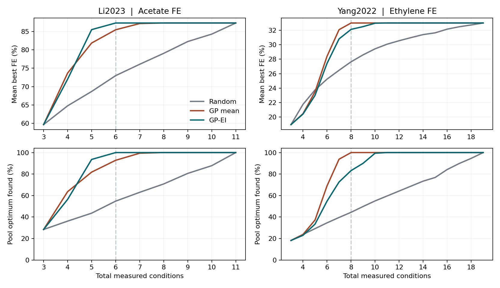

# Phase 2 · Retrospective Bayesian optimization for CO₂ reduction

A fixed-pool replay of experiment selection. Each policy starts from the same three measured conditions. It then chooses among the remaining published conditions, one at a time, with the corresponding FE revealed only after selection. The policies are Gaussian process expected improvement (GP-EI), Gaussian process posterior-mean selection (GP mean), and uniform random selection.

## Main results

The table uses the primary kernel length scale and 500 paired initializations/orderings per cohort. The budgets include the initial three conditions.

| Cohort and budget | Policy | Mean best FE | Best recorded condition found |
| --- | --- | ---: | ---: |
| Li et al., 6 of 11 conditions, acetate | Random | 73.0% | 54.8% |
| Li et al., 6 of 11 conditions, acetate | GP mean | 85.5% | 92.8% |
| Li et al., 6 of 11 conditions, acetate | GP-EI | 87.3% | 100.0% |
| Yang et al. as curated by Wang Group, 8 of 19 conditions, ethylene | Random | 27.6% | 44.4% |
| Yang et al. as curated by Wang Group, 8 of 19 conditions, ethylene | GP mean | 33.0% | 100.0% |
| Yang et al. as curated by Wang Group, 8 of 19 conditions, ethylene | GP-EI | 32.1% | 83.2% |

On the Li pool, GP-EI improved mean best FE by **14.3 percentage points** versus random at budget six (paired replay bootstrap interval 12.9–15.8). It tied random in 54.8% of the replays and exceeded random in the remaining 45.2%. All three tested kernel length scales yielded 100% GP-EI optimum hit rate at this budget. The exact uniform-random probability is 6/11 or 54.5% for one unique optimum. The 54.8% simulation estimate is consistent with that probability.

On the secondary pool, GP-EI improved mean best FE by **4.5 percentage points** versus random at budget eight (paired replay bootstrap interval 3.9–5.1), while the simpler GP mean policy performed better at all three tested length scales at this budget. Thus GP-EI's advantage over a GP greedy policy depended on the candidate pool.



## Interpretation

The Li result uses 11 unique candidates reconstructed from **explicitly printed mean values** in three figures. The data lie on separate one-variable sweeps around a shared condition, so the replay may favor policies that exploit that structure. The candidate list was fixed in advance by the source figures. The bootstrap describes variation over simulated initial conditions and query orderings within these fixed pools. A condition may summarize several experimental replicates, and the retrospective replay gives neither a prospective validation nor a measured reduction in the number of physical experiments.

The next test on an expanded dataset would need comparable candidate-level FE for joint changes in operating conditions, and ideally raw replicates and experimental costs. The Li replay holds electrolyte formulation fixed, so it does not evaluate concentration, cation identity, temperature or energy efficiency.

## Reproduce

Python 3.12.14 and CPU only. From this folder:

```bash
python -m pip install -r requirements.txt
OPENBLAS_NUM_THREADS=1 python run.py --output reproduced
```

The script fetches the pinned workbook for the secondary cohort and checks its SHA-256. Use `--li-only` for the primary cohort without network, or pass `--workbook /path/to/workbook.xlsx` to provide a previously downloaded source. Outputs include the complete budget curves, summary JSON, plot and per-query trace for the primary kernel length scale. The tracked reference trace is gzip-compressed. Decompress it to compare with the generated CSV. Refer to [protocol](PROTOCOL.md) and [source provenance](SOURCES.md) for design and data details.

A fresh run using the automatic source download matched all four included result files byte for byte. All 3,000 primary-scale trajectories were checked for paired starts, no repeated selections and correct next-step scoring from observations already revealed. Primary metrics were recomputed from the selection traces and source outcomes.
