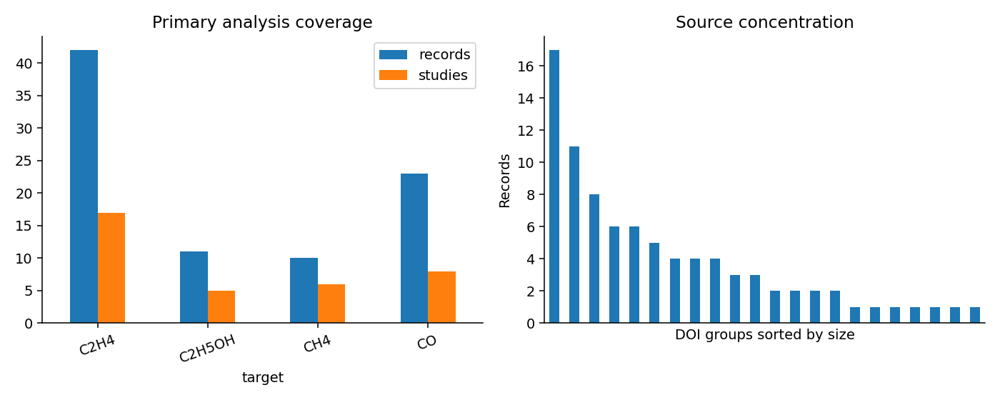
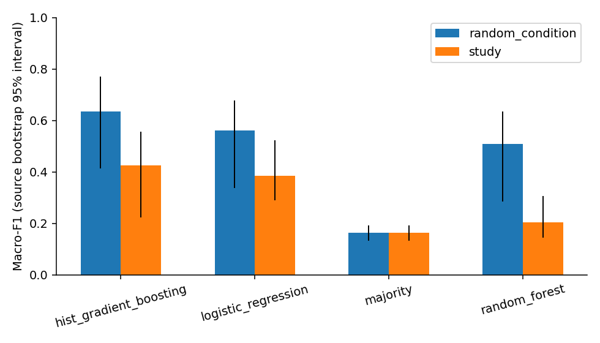
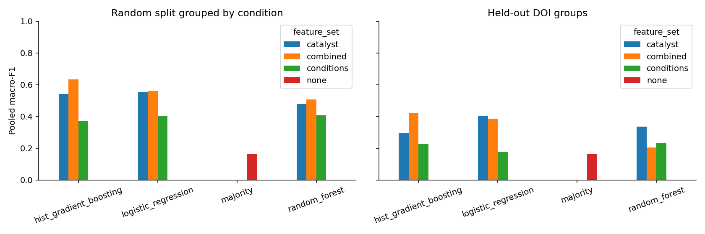
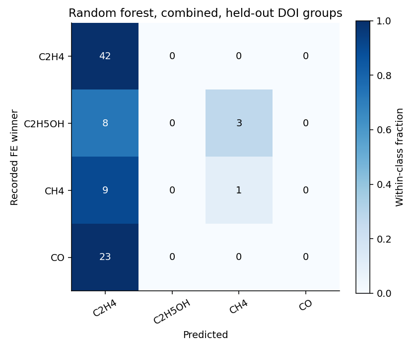
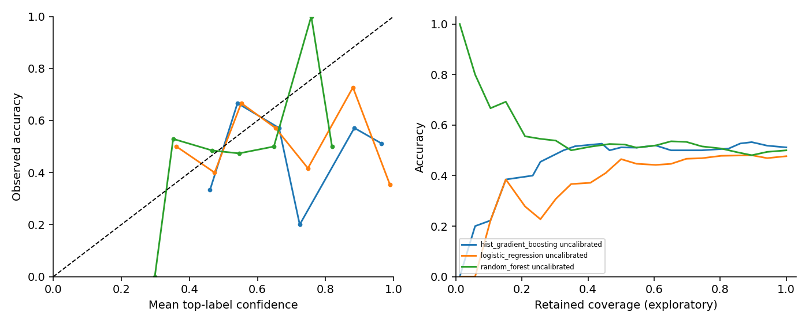
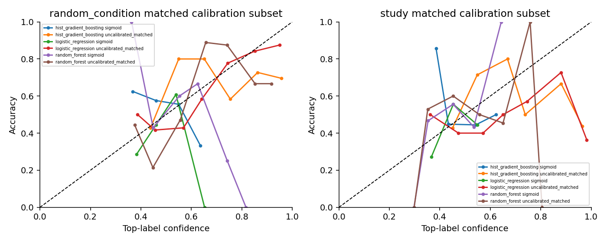

# Cross-study prediction and reliability of reported CO2 electroreduction product labels

A reproducible evaluation of a public, literature-derived dataset of organically modified copper catalysts

Prepared for Qi (Mia) Zhang. Computational evaluation; no new experiments. Analysis date: 9 November 2026.

## Abstract

We audited public CO2 electroreduction (CO2RR) data before modeling and compared random condition-grouped evaluation with held-out-paper evaluation. The two initial candidates were not acquired as usable tables. A separate public workbook linked to He et al. [1] supplied 322 raw rows; 86 conditions from 22 explicit DOI groups passed the primary rules. The target is the individual carbon species with the highest explicitly reported numeric Faradaic efficiency (FE), among at least two reported species. It is not a verified full-distribution dominant product. Fixed small classifiers compared modifier-derived catalyst features, conditions, and their combination. For the prespecified random forest combined-feature reference, pooled macro-F1 was 0.508 under random condition grouping and 0.205 under held-out DOI grouping, against a held-out-DOI majority baseline of 0.164. These are conditional results on a small, selected copper dataset; they do not establish broad CO2RR generalization, mechanistic causality, or experimentally validated recommendations.

## 1. Background and questions

CO2RR outcomes depend on both catalyst and reaction conditions. Li et al.'s high-pressure acetate study [2] supplies scientific context, but its data are not used here and pressure cannot be inferred where absent. Prior work already applies machine learning to literature-derived CO2RR data [1,3,4]. This project is an evaluation study using standard classifiers, not a new learning method or a claim of first use.

We ask: (RQ1) how does performance change between random condition-grouped and paper-disjoint evaluation; (RQ2) what predictive value do catalyst information and conditions provide separately and together; and (RQ3) how reliable are outer-test probabilities, including after training-side sigmoid calibration? Directions of all comparisons were left open. The implementation requirements governed execution; proposal claims were treated as unverified background until checked.

## 2. Data acquisition, provenance and task

Candidate A [4] reports 662 observations from 47 studies, but its exact linked GitHub repository and spreadsheet returned 404; alternative public retrieval attempts did not acquire the table. Candidate B [3] reports 3,880 postprocessed literature-extracted conditions; its direct publisher and possible supplementary routes returned 403. Neither claimed sample count enters this experiment. A predecessor supplement [5] was actually downloaded: 4,286 spreadsheet rows and 383 opaque `pdfs_N.pdf` names. Without an unambiguous mapping to papers, these names were not accepted as study identifiers. Complete access logs, metadata and hashes are in `docs/source_a.md`, `docs/source_b.md` and their evidence directories.

The admitted source is the Wang Group repository for He et al. [1]. Its README describes 237 points from 33 selected papers; the downloaded raw workbook version actually contains 322 rows in `Sheet1`. This broader workbook includes controls and notes, so those numbers are not interchangeable. Its SHA256 is `6b4277e0eb681dee284533854b467089395aa1957681f8ba6a09636e9c552793`. The repository API identifies Apache-2.0, while licensing of its underlying third-party literature measurements is not separately established. The redistribution package omits the raw workbook and supplies pinned retrieval instructions. Public accessibility alone is not treated as a license.

Explicit citation headers and numbered source blocks define provenance. Continuation rows inherit only their current documented citation; a new numbered source without a citation resets attribution. DOI strings are parsed from explicit citations or explicit Nature article URLs, never guessed from conditions or authors. Every retained row preserves its workbook row, worksheet, citation-header row, DOI, stable record ID and condition hash. These are traceable source attributions, although every original publication's measurements have not been independently re-extracted.

For each row, only explicitly numeric individual-carbon FE values in [0,100] participate in target construction. We require at least two reported species and a unique positive maximum. H2 and aggregate C2+/C3+ values are excluded from this comparison. Blank FE remains unreported, not zero; rows with nonempty nonnumeric individual-species FE are excluded before ranking. Consequently a label describes the highest reported member of an incomplete species set, not a sole product, full product distribution, or guaranteed experimental maximum.

Controls, notes, unresolved citations, unparsable modifier representations, invalid outcomes and ambiguous ties are excluded by scripts. Identical recorded conditions with conflicting labels would be excluded together. One identical-label duplicate is collapsed with its lineage retained. The audit yields 99 conditions in 23 DOI groups before primary class filtering. Primary classes require at least 10 conditions and three DOI groups, leaving 86 conditions (26.7% of raw rows). Rare classes are disclosed, not merged.

| Reported FE winner | Audited conditions | DOI groups | Primary eligible |
| --- | --- | --- | --- |
| C2H4 | 42 | 17 | True |
| C2H5OH | 11 | 5 | True |
| CH3CO2H | 5 | 1 | False |
| CH4 | 10 | 6 | True |
| CO | 23 | 8 | True |
| HCOOH | 8 | 3 | False |

The largest primary source contributes 17 of 86 conditions (19.8%). Primary exclusions are selection restrictions, not random missing observations. Detailed first-applicable exclusion counts, all modifications and duplicate membership are saved in the audit files.



## 3. Frozen methods and leakage controls

`evaluation_protocol.md` and the versioned configuration freeze the target, inclusion rules, feature sets, classes, metrics, seed 20261109, folds and fixed model budget before outer results are examined. This is a local prospective protocol, not a public preregistration. There is no hyperparameter search or test-driven model selection.

Catalyst features are lexical counts of explicit atom tokens in the recorded modifier representation plus a broad polymer/MOF/COF category. They are simple representations, not validated molecular formulas, comprehensive catalyst descriptions, or new DFT calculations. Conditions comprise the reported numeric RHE potential, qualitative pH, electrolyte and reactor. Raw modifier strings, DOI, titles, years, measured FE, measured current and target-derived fields are excluded. No undocumented potential conversion, pressure imputation, or zero replacement for unknown concentrations is performed. Source potential annotations that do not establish numeric RHE voltage remain missing.

The four models are a majority baseline, regularized multinomial logistic regression, random forest and histogram gradient boosting. Each nonbaseline model uses catalyst-only, conditions-only and combined features on identical records and splits. Training pipelines fit imputation, scaling and one-hot encoding on their own training records, with unknown-category support. Hyperparameters are fixed and CPU-oriented. Missingness is not assumed chemically neutral.

Three-fold outer evaluation compares (a) a random split grouped by repeated recorded conditions and (b) DOI-disjoint folds. Every primary record obtains one outer prediction per run; repeated predictions are not counted as new observations. A condition key includes source DOI, exact modifier representation and recorded conditions. DOI and condition overlaps are asserted absent across their relevant boundaries. This cannot prove that differently encoded conditions or distinct papers never share unrecognized experimental data.

Where viable, sigmoid calibration uses source-disjoint training-side folds; the entire pipeline is refitted within each calibration-training fold. Training-side class/source checks permit calibration for all random outer folds, but only two of three held-out-source folds. The source-disjoint calibrated analysis therefore covers 56/86 conditions in 14 DOI groups. The omitted outer fold lacks viable calibration class coverage; its uncalibrated predictions remain in the primary experiment. Matched calibration comparisons restrict both models to the same eligible subset, and are secondary. Outer-test records cannot fit preprocessing or calibrators. Missing training classes retain their probability columns and test errors are counted. Saved fold manifests and fit-role logs provide reviewable separation evidence.

Primary metrics are macro-F1 over the fixed four-class set and per-class recall. Accuracy provides context. Equal-study macro-F1 is computed from one global confusion matrix with each record weighted by the reciprocal of its source's record count; it is not an average of single-paper macro-F1 scores. Percentile uncertainty intervals resample DOI groups using saved outer predictions, without refitting models. Paired feature/calibration comparisons use the same source draws and test records. Split-protocol differences are descriptive because their training information differs.

## 4. Executed prediction results

The following values are recomputed from `results/predictions.csv`; all models use the same primary cohort. Columns labeled random use the condition-grouped random protocol; study uses held-out DOI groups. The majority model is feature-independent.

| Model | Random macro-F1 | Study macro-F1 | Random accuracy | Study accuracy | Study equal-source F1 |
| --- | --- | --- | --- | --- | --- |
| Majority | 0.164 | 0.164 | 0.488 | 0.488 | 0.183 |
| Logistic regression | 0.562 | 0.385 | 0.663 | 0.477 | 0.490 |
| Random forest | 0.508 | 0.205 | 0.616 | 0.500 | 0.207 |
| Gradient boosting | 0.634 | 0.424 | 0.674 | 0.512 | 0.413 |

For the prespecified random forest combined-feature reference, held-out-source macro-F1 is 0.205 (source-bootstrap 95% interval 0.144 to 0.307); its random-minus-study difference is +0.303. All three combined-feature classifiers scored lower under paper-disjoint evaluation in this particular run. The result supports caution about study overlap here; it does not show that the same direction holds in every dataset. These intervals characterize the observed source sample conditional on fitted outer models, not uncertainty under arbitrary future-study shift.



### Feature ablation

| Model | Catalyst F1 | Conditions F1 | Combined F1 |
| --- | --- | --- | --- |
| Gradient boosting | 0.293 | 0.227 | 0.424 |
| Logistic regression | 0.401 | 0.179 | 0.385 |
| Random forest | 0.337 | 0.234 | 0.205 |

Paired source-bootstrap differences (combined minus single feature group):

| Model | Subtract feature group | F1 difference | 95% lower | 95% upper |
| --- | --- | --- | --- | --- |
| Gradient boosting | catalyst | 0.131 | 0.028 | 0.255 |
| Gradient boosting | conditions | 0.197 | 0.003 | 0.351 |
| Logistic regression | catalyst | -0.016 | -0.080 | 0.060 |
| Logistic regression | conditions | 0.206 | 0.045 | 0.387 |
| Random forest | catalyst | -0.132 | -0.242 | 0.110 |
| Random forest | conditions | -0.029 | -0.127 | 0.088 |

Combined features improve gradient-boosting F1 relative to either feature group here, while combined random forest scores below its catalyst-only and conditions-only versions; logistic regression also does not improve over catalyst-only. Thus complementarity is model-dependent, not a universal gain. Intervals crossing zero do not provide a clear directional advantage in this small source sample; noncrossing intervals still do not establish causal chemical effects or independent external replication. A combined model's numerical ranking is not evidence that every feature transfers. Catalyst features describe modifiers within copper systems, so this ablation cannot compare elemental catalyst families across all CO2RR.



### Class coverage and errors

| Class | Conditions | Sources | Precision | Recall | F1 |
| --- | --- | --- | --- | --- | --- |
| C2H4 | 42 | 17 | 0.512 | 1.000 | 0.677 |
| C2H5OH | 11 | 5 | 0.000 | 0.000 | 0.000 |
| CH4 | 10 | 6 | 0.250 | 0.100 | 0.143 |
| CO | 23 | 8 | 0.000 | 0.000 | 0.000 |

The reference random forest has zero recall for ethanol and CO, despite 50.0% overall accuracy. Its low macro-F1 therefore reflects severe class collapse. Gradient boosting and logistic regression recover more minority classes, but their full-cohort source-disjoint log losses are 2.010 and 5.745, respectively, indicating that stronger discrimination does not guarantee trustworthy probabilities. Logistic regression's equal-study macro-F1 (0.490) exceeds its record-pooled value (0.385), showing sensitivity to source weighting. The reference confusion matrix exposes which products are confused. Minority-class recall must be considered alongside aggregate accuracy; majority-class concentration can hide missed classes. The saved `per_class.csv` contains every model, feature set and calibration variant.



## 5. Reliability and failure analysis

Probabilities are checked finite, nonnegative and summing to one, with a fixed class-column order. Multiclass log loss clips true-class probability at 1e-15. The Brier score is the mean over records of the sum across classes of squared probability error; it is not divided by the number of classes and ranges from 0 to 2. Reliability diagrams use ten fixed top-label-confidence bins; small bin supports limit interpretation.

Full-cohort source-disjoint probability metrics (uncalibrated):

| Combined model | Log loss | Brier | Macro-F1 |
| --- | --- | --- | --- |
| Gradient boosting | 2.010 | 0.831 | 0.424 |
| Logistic regression | 5.745 | 0.887 | 0.385 |
| Random forest | 1.336 | 0.677 | 0.205 |

Matched eligible-subset calibration comparison: 56 conditions / 14 DOI groups. These scores must not be compared directly with the full-cohort scores above.

| Model | Calibration | Conditions | Log loss | Brier | F1 |
| --- | --- | --- | --- | --- | --- |
| Gradient boosting | Sigmoid | 56 | 1.272 | 0.678 | 0.167 |
| Gradient boosting | Raw (matched) | 56 | 2.193 | 0.892 | 0.400 |
| Logistic regression | Sigmoid | 56 | 1.380 | 0.725 | 0.197 |
| Logistic regression | Raw (matched) | 56 | 1.867 | 0.768 | 0.438 |
| Random forest | Sigmoid | 56 | 1.500 | 0.712 | 0.245 |
| Random forest | Raw (matched) | 56 | 1.352 | 0.687 | 0.226 |

Calibration differences below are sigmoid minus uncalibrated on identical eligible held-out sources; negative probability-loss differences favor calibration. The excluded calibration fold limits representativeness, so this is not full-cohort calibration validation. All calibration parameters use training-side source groups.

| Model | Log-loss difference | 95% lower | 95% upper | Brier difference |
| --- | --- | --- | --- | --- |
| Gradient boosting | -0.921 | -1.749 | 0.178 | -0.214 |
| Logistic regression | -0.487 | -1.405 | 0.392 | -0.043 |
| Random forest | 0.148 | -0.246 | 0.859 | 0.025 |

On the matched subset, sigmoid lowers gradient-boosting log loss from 2.193 to 1.272 while lowering F1 from 0.400 to 0.167; logistic regression shows the same loss-versus-F1 tradeoff. Random-forest log loss instead changes from 1.352 to 1.500. Thus calibration has no consistent improvement across criteria. Loss, calibration-bin behavior and discrimination must be assessed together; finite source coverage prevents a universal reliability guarantee. Confidence-coverage curves describe the saved outer predictions and include confidence ties. They are exploratory test curves, with no deployment threshold selected or certified from them.





High confidence does not reliably eliminate failure: the single most confident gradient-boosting and logistic-regression source-disjoint predictions are both incorrect. This extreme one-record endpoint is illustrative only; all curve points retain their sample and study counts in `risk_coverage.csv`.

| Subgroup field | Value | Conditions | Sources | Reference accuracy |
| --- | --- | --- | --- | --- |
| reactor | GDE | 40 | 7 | 0.600 |
| reactor | H-Cell | 45 | 15 | 0.400 |
| reactor | missing | 1 | 1 | 1.000 |
| polymer_category | MOF | 17 | 5 | 0.294 |
| polymer_category | missing | 3 | 2 | 0.667 |
| polymer_category | nonpolymer | 51 | 9 | 0.471 |
| polymer_category | polymer | 15 | 8 | 0.800 |
| missing_pattern | none | 72 | 19 | 0.458 |
| missing_pattern | polymer_category | 3 | 2 | 0.667 |
| missing_pattern | potential_rhe_v | 10 | 3 | 0.700 |
| missing_pattern | potential_rhe_v,reactor | 1 | 1 | 1.000 |
| catalyst_family | N-containing modifier | 71 | 15 | 0.535 |
| catalyst_family | O-containing, no N modifier | 9 | 4 | 0.111 |
| catalyst_family | other modifier | 6 | 6 | 0.667 |

The identity-proxy audit finds 4 of 10 recorded electrolyte categories occur in only one DOI group, covering 24/86 records. This shows available study-identity cues; it does not prove that a fitted model causally depends on them. Missing-pattern strata and equal-source scores provide additional checks rather than removing that concern. The `catalyst_family` diagnostic labels modifier token composition, not different base metals. Subgroup results are descriptive and require their displayed source support. All retained catalysts are copper-based, so this cohort cannot establish a copper-versus-noncopper comparison. Polymer categories and missingness may proxy paper-specific practices; no subgroup difference is interpreted as mechanism. For the prespecified reference, leaving one source out of the already saved evaluation changes pooled macro-F1 by -0.037 to +0.020. This is evaluation influence, not retraining or a causal source effect. `study_errors.csv`, `subgroup_errors.csv` and `source_influence.csv` preserve detailed failures.

## 6. Limits and conclusions

The main restriction is scale and selection: only 86 of 322 workbook rows meet provenance, label and representation rules, and four classes remain. Availability and reporting determine the task. Different products may be absent from the table because they were unreported; the model can learn a reporting process as well as chemistry. A modest reported FE margin may change rank under experimental error, which the table cannot quantify consistently.

Source citations are auditable, but original-paper values and pre-outcome availability of retrospectively chosen “typical” conditions have not all been independently verified. Exact-string condition grouping cannot detect every equivalent chemistry, unreported replicate, or shared dataset across distinct DOIs. Lexical modifier features discard bonding and detailed morphology; the recorded electrolyte strings can be high-cardinality study proxies. Reactor labels and missing patterns can similarly identify source practices. The source-bootstrap intervals do not include model retraining, acquisition selection or label uncertainty. Only one fixed seed and fold assignment were run; this is not an independent prospective test.

Within those limits, the saved predictions answer the three questions for this specific public cohort: protocol results and feature contributions are measurable rather than assumed, and calibration can be evaluated against untouched outer sources. The defensible contribution is an executable provenance audit and careful benchmark, including negative or uncertain comparisons. It supplies no new chemical mechanism, guaranteed innovation, full product-distribution predictor, or experimentally validated design recommendation. Broader claims require better documented public data and additional independent studies, not invented records or new wet-lab experiments within this project.

## 7. Reproduction and artifacts

From the project root, use Python 3.12 and install the pinned environment, then run:

```bash
python -m pip install -r requirements.txt
python scripts/reproduce.py
```

The executed benchmark has 75 saved outer fit/calibration entries and 2,146 outer prediction rows across protocols, models, features and calibration states; these rows are not independent new experiments. The actual integrity suite passed 10/10 tests (`results/tests.log`). A separate clean-output rerun reproduced 46 substantive result files and 6 figures byte for byte, with fit provenance matching apart from runtime fields (`results/reproduction_check.json`).

Raw retrieval is pinned by commit and SHA256 and recreates missing measurement tables rather than redistributing them. The workflow regenerates audit lineage, fixed splits, predictions, metrics, figures and reports; source changes fail the hash check. Tests verify source/condition separation, fitting-role isolation, forbidden fields, class/probability alignment, row accounting and independently reconstructed metrics. These establish implementation properties, not chemical ground truth. The README documents stages and limitations.

## References

[1] He X, Su Y, Zhu J, et al. Uncovering the influence of the modifier redox potential on CO2 reduction through combined data-driven machine learning and hypothesis-driven experimentation. Journal of Materials Chemistry A 11, 18106–18114 (2023). https://doi.org/10.1039/D3TA03115B . Data: https://github.com/Wang-Group/Cu-CO2RR_modifiers .

[2] Li J, Kuang Y, Zhang X, et al. Electrochemical acetate production from high-pressure gaseous and liquid CO2. Nature Catalysis 6, 1151–1163 (2023). https://doi.org/10.1038/s41929-023-01046-8 . Scientific context only.

[3] Farris BR, Meckstroth JJ, Leonard KC. Interpretable, low-compute machine learning integrating experimental and catalytic descriptors for sustainable CO2 electroreduction. Green Chemistry 28, 11779–11789 (2026). https://doi.org/10.1039/D6GC01753C . Candidate, not acquired as analysis data.

[4] Günay ME, Tapan NA, Alzeer LKS. Multivariate Analysis of CO2 Electroreduction for Fuel and Value-Added Chemical Production Using Explainable Machine Learning. International Journal of Energy Research 2026, article 2400202 (2026). https://doi.org/10.1155/er/2400202 . Candidate, not acquired as analysis data.

[5] Farris BR, Leonard KC. Accelerating Catalysis Understanding via Large Language Model Data Extraction and Shallow Machine Learning Techniques. JACS Au 5, 5578–5589 (2025). https://doi.org/10.1021/jacsau.5c01087 . Downloaded supplement excluded for unresolved paper mapping; SI DOI https://doi.org/10.1021/jacsau.5c01087.s003 .
